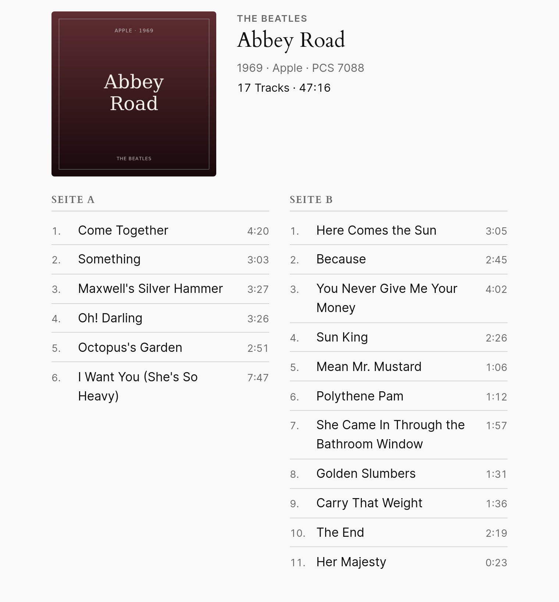
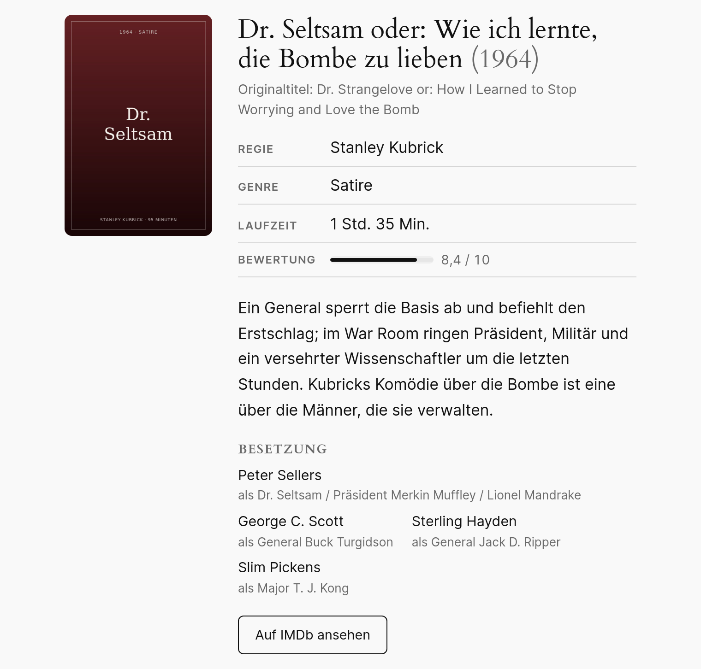
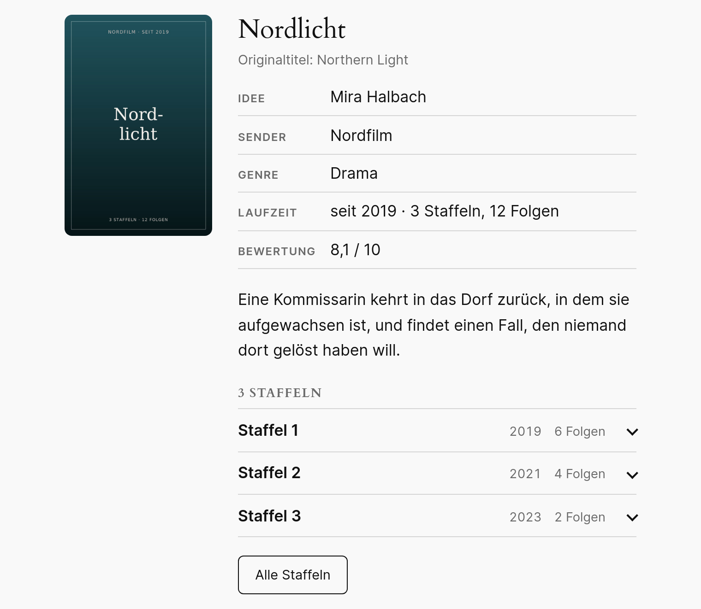

# PhoenixSEO Page Builder

A component-based page builder for WordPress that uses **Advanced Custom Fields** and **Secure Custom Fields** as its field providers — and stores pages as a single JSON document.

**Status: 0.3.1, in the WordPress.org directory.** Install it from [wordpress.org/plugins/phoenixseo-page-builder](https://wordpress.org/plugins/phoenixseo-page-builder/) — the SVN repository is the release channel, this one is where the code and its history live. The plugin site with the component catalog is [components.phoenixseo.de](https://components.phoenixseo.de/).

Editor, storage, frontend output, revisions and import/export are in place and measured: the PHP suite is green on WordPress 7.1.4 **and** on the declared minimum 6.4.14, against ACF **and** SCF — 378 tests, 2165 assertions, exit 0 in every run. PHPCS clean, Plugin Check clean on the built package, readme.txt formally valid, three screenshots in the package.

## Three of the ten example components

All three images are the plugin's own output on a demo page using the shipped examples — no mockup, no theme in between. Captured at 1280 px width, at twice the pixel density.

**`vinyl`** — the track number comes from the row order and the total running time is added up from the individual durations. Neither is a field.



**`movie`** — facts as a definition list, the rating as a `<meter>`, the running time written from a number of minutes.



**`series`** — every season is a `<details>` element, operable from the keyboard and without a line of JavaScript.



## Why this exists

A CMS separates content from presentation. The common page builders do the opposite: they store the content together with the markup — as a block attribute, as HTML, as a serialized tree. Whoever changes a component afterwards has to follow up on every page individually. The content sits fixed in the code, and that is exactly where a CMS stops being a CMS.

This builder turns that back around. A component is a directory: field definition, markup, styles. A page stores **only** which components appear in which order and which values their fields hold — none of how it looks.

Three properties follow from that:

- **One change reaches everywhere.** Whoever touches a component's `render.php` changes every instance on every page. No migration, no search-and-replace, no "this only affects the new pages".
- **A component is a directory.** Defining one means: create a directory, put JSON in it. No plugin, no PHP class, no new field type. The same directory can be copied into another theme and works there — it brings its definition along.
- **Administer instead of assembling.** The components are a catalog, sorted and countable, not a heap of layouts in a database. What exists sits in the filesystem and can be versioned.

The carriers are ACF and SCF — they provide the field types and the admin UI for filling them in. Storage and rendering are the plugin's own.

### What that means technically

Because only values are stored, the document is small: 30 components are **one** meta entry of 12,583 bytes instead of 1,933 rows at two rows per subfield. Saving costs **4 queries / 8 ms** against 1,807 queries / 733 ms.

And because the document travels as JSON over REST instead of as a form, `max_input_vars` does not apply. Those same 30 components produce **1,373 fields** in an ACF form; at `max_input_vars = 1000` PHP accepts only the first 1,001 and drops the rest without an error — the page reports "saved" and has lost a quarter of its content. That is the reason for the separate save path, not the reason for this plugin.

## What is measured

| Check | Result |
|---|---|
| Saving 30 components | **7.9 ms / 4 queries** |
| Meta rows for the whole page | **1** (12,583 bytes) |
| Roundtrip (reading back = what was written) | exact, umlauts intact, IDs stable |
| Revisions | document is versioned, undo/restore possible |
| Unknown component type | rejected, not silently dropped |
| Platform | WordPress + SCF 6.9.7, PHP 8.3 |

Reproducible: `wp eval-file plugin/tests/m1-verify.php 30`

## What Single Directory Components are

You want to be able to pick up a component without hunting for it. **Single Directory Components** (SDC, "a component in one directory") means exactly that: definition, markup, styles, scripts and docs for one building block live in **one directory**. Not spread across `templates/`, `css/` and `js/`.

The name comes from Drupal. There, SDC was an experimental module from version 10.1 and has been part of core since 10.3. The convention looks like this:

```
my_theme/components/card/
├── card.component.yml    Metadata: props and slots
├── card.twig             Markup
├── card.css              Styles, loaded automatically when rendering
└── card.js               Behaviour, also loaded automatically
```

Drupal checks every leaf directory under `components/` for a `.component.yml`. If it is missing, the directory is ignored. That is why you can put `atoms/`, `molecules/` and `organisms/` in between without disturbing discovery — the leaf is what counts. The `.component.yml` describes the **props** (values the component expects) and the **slots** (content you put inside it).

The gain is not the file format but the question "where does this belong?". It has exactly one answer. And throwing something away is an `rm -r`.

### Where the idea comes from

Brad Frost described the pattern in *Atomic Design* (2016, free online at [atomicdesign.bradfrost.com](https://atomicdesign.bradfrost.com/)): interfaces consist of building blocks that assemble into larger building blocks — atoms, molecules, organisms, templates, pages. His tool for it was [Pattern Lab](https://patternlab.io/), a static generator that reads patterns from directories, nests them inside each other and outputs them as a pattern library.

Two thoughts from it still carry:

- **Nest instead of copy.** Whoever changes the card changes all cards. Frost compares this to Russian dolls.
- **Think about provenance.** Pattern Lab shows for every pattern what it consists of and where it is used. That is the basis for the question "what breaks if I change this?".

SDC is Drupal's name for the discipline, not Frost's. The idea behind it is his.

### What you can do with it

- **One building block, many pages.** The type is defined once. Each page stores only its values and an `_id` — not a copy of the markup.
- **Several instances per page.** Two FAQ blocks are two entries of the same type, each with its own prefix. They do not collide.
- **Markup belongs to the theme.** A `render.php` changes how a component looks without touching the plugin — and without the next plugin update overwriting the change.
- **Evolve without legacy debt.** The document carries `schema: "teaser@1"`. When fields are added, old content stays readable.
- **Move house.** Copying one directory brings the component into another project. Content travels along as a JSON export.
- **Intervene conditionally.** A filter can rewrite a component or leave it out — for visitors who are not logged in, for instance.
- **A design system without an extra tool.** A page that shows every component once *is* the pattern library. That needs no Storybook and no second build.
- **Reuse outside the builder.** `Sdcpb_Frontend::component_fields_html( $type, $data )` returns the same field markup inside an ordinary theme template. The field definition therefore holds in both places.

### And in the PhoenixSEO Page Builder

| Drupal SDC | PhoenixSEO Page Builder |
|---|---|
| `components/<name>/` | `sdc-components/<name>/` |
| `<name>.component.yml` — props and slots | `definition.json` — ACF field group, fields are the props |
| `<name>.twig` | `render.php` |
| `<name>.css`, `<name>.js`, loaded automatically | not automatic — the theme loads its assets as it always does |
| Props arrive as arguments when rendering | `$data` in the template, the stored values |
| Slots for nested content | none — components are siblings in a list |

Two differences are worth knowing before you transfer SDC expectations:

**No slots.** A component does not take other components as its content. Nesting arises through the order on the page, not through parameters. Whoever wants deeper nesting builds the container as its own type with its own fields.

**No automatic assets.** `render.php` returns markup and nothing else. CSS and JS come from the theme's normal asset chain. That is deliberate: a plugin that pulls in stylesheets unasked collides with every build setup.

### Example: a teaser component

Two files in one directory, that is all it takes.

```
wp-content/themes/<your-theme>/sdc-components/teaser/
├── definition.json
└── render.php
```

**1. The fields** — `definition.json`:

```json
{
  "key": "group_sdcpb_component_teaser",
  "title": "Teaser",
  "sdcpb_description": "Card with heading, text and link.",
  "sdcpb_icon": "screenoptions",
  "sdcpb_version": 1,
  "fields": [
    { "key": "field_sdc_teaser_heading", "label": "Heading", "name": "heading", "type": "text", "required": 1 },
    { "key": "field_sdc_teaser_text", "label": "Text", "name": "text", "type": "textarea", "required": 0, "rows": 3 },
    { "key": "field_sdc_teaser_link", "label": "Link", "name": "link", "type": "link", "required": 0, "return_format": "array" }
  ],
  "location": [
    [ { "param": "sdcpb_component", "operator": "==", "value": "1" } ]
  ],
  "menu_order": 0,
  "position": "normal",
  "style": "default",
  "label_placement": "top",
  "instruction_placement": "label",
  "active": true,
  "description": ""
}
```

Three things matter here. The key in the JSON starts with `group_sdcpb_component_`; the rest is the type (`teaser`). The file name says nothing about the type — it is `definition.json` in every component directory, because the key determines it. Each field has its own key and a `name` under which the value lands in the document. And the location rule `sdcpb_component == 1` keeps the group away from the normal metaboxes.

**2. The markup** — `render.php`:

```php
<?php
$link = isset( $data['link'] ) && is_array( $data['link'] ) ? $data['link'] : array();
?>
<article class="teaser">
	<h3 class="teaser__title"><?php echo esc_html( $data['heading'] ?? '' ); ?></h3>

	<?php if ( ! empty( $data['text'] ) ) : ?>
		<p class="teaser__text"><?php echo esc_html( $data['text'] ); ?></p>
	<?php endif; ?>

	<?php if ( ! empty( $link['url'] ) ) : ?>
		<a class="teaser__link" href="<?php echo esc_url( $link['url'] ); ?>">
			<?php echo esc_html( $link['title'] ?? $link['url'] ); ?>
		</a>
	<?php endif; ?>
</article>
```

**3. Use it.** Open a page, pick "Teaser" in the builder, fill in the fields, save. The frontend shows `<article class="teaser">`; nothing in that HTML hints at the builder.

**4. Style it.** `render.php` returns markup only. The CSS belongs to the theme — `wp_enqueue_style()` in `functions.php`, one stylesheet per component, or whatever your build already does.

Changing the fields afterwards changes the type for **all** pages that use it. New fields are harmless. Renaming a field means old values sit under the old name. That is why `sdcpb_version` is in the JSON and `schema` in the document — the migration hangs on the version, not on luck.

## Layout

```
plugin/
├── phoenixseo-page-builder.php              Bootstrap, GPL header, admin notice when no host is active
├── includes/
│   ├── class-sdc-field-adapter.php   the only place with acf_* calls
│   ├── class-sdc-store.php           _sdcpb_data: one key, one write, revisions
│   ├── class-sdc-schema.php          components = field groups with group_sdcpb_component_*
│   └── class-sdc-rest.php            sdc-pb/v1/pages/{id}, sdc-pb/v1/components
├── schemas/                          shipped example components (ten, one directory each)
└── tests/m1-verify.php               20 checks, end to end
```

**Data model:** one meta key per page.

```json
{
  "v": 1,
  "components": [
    { "_id": "c_7f3a91bd", "type": "faq", "schema": "faq@1", "data": { "items": [ ... ] } }
  ]
}
```

`_id` gives every component a stable identity for sorting and undo. `schema` allows versioning: old data stays readable, migration happens on read.

**Defining components:** a field group as JSON with the key prefix `group_sdcpb_component_`. The rest of the key is the type (`group_sdcpb_component_faq` → `faq`). A location rule on `sdcpb_component == 1` makes sure the host never renders the group as a normal metabox.

## Creating your own components

A component type is a directory — JSON for the fields, optionally `render.php` for the markup:

```
wp-content/themes/<your-theme>/sdc-components/
└── hero/
    ├── definition.json    field group (required)
    └── render.php         markup (optional)
```

Lookup happens in this order, first hit wins:

1. `get_stylesheet_directory()/sdc-components/` — child theme
2. `get_template_directory()/sdc-components/` — parent theme
3. `WP_CONTENT_DIR/sdc-components/` — survives a theme switch

Other locations via filter:

```php
add_filter( 'sdcpb_component_dirs', function ( $dirs ) {
    $dirs[] = __DIR__ . '/my-components';
    return $dirs;
} );
```

Do **not** write into `plugin/schemas/`: that is where the shipped examples live, and the directory belongs to the plugin — your own files are gone with the next update.

### `render.php`

The file runs in the scope of the renderer method and sees three variables:

| Variable | Contents |
|---|---|
| `$type` | component type, e.g. `hero` |
| `$data` | stored values of this instance, raw from the document |
| `$component` | the complete document entry (`_id`, `type`, `schema`, `data`) |

```php
<article class="hero">
	<h2><?php echo esc_html( $data['heading'] ); ?></h2>
	<p><?php echo esc_html( $data['subline'] ); ?></p>
	<?php echo Sdcpb_Frontend::component_fields_html( $type, $data ); ?>
</article>
```

Two things are deliberate: `$data` arrives **unescaped** (escaping is the template's job — this is theme code, the same trust boundary as a template part), and `Sdcpb_Frontend::component_fields_html()` returns the default markup of the fields when only the frame is meant to be custom. Without a `render.php` the plugin renders generically (`div.sdc-component--<type>` with `sdc-field--<name>` spans).

### Last word: the filter

```php
add_filter( 'sdcpb_component_html', function ( $html, $type, $data, $component ) {
    if ( 'hero' === $type && empty( $data['heading'] ) ) {
        return ''; // leave the component out
    }
    return $html;
}, 10, 4 );
```

The filter runs **after** the template and has the last word; an empty return value removes the component from the page.

### One directory per component — why

ACF reads Local JSON only one level deep (`scan_files()` skips subdirectories). The plugin therefore registers each subdirectory of `sdc-components/` as a load path individually — which is what makes "one directory per component" work with an unchanged ACF loader. Because every component has its directory to itself, the definition file is named the same everywhere: `definition.json`. The name says nothing about the type; the group key inside the JSON does.

Saving from the admin writes back into the component's directory, not into `acf-json/` — two files with the same key would be two definitions of the same component.

## Managing components in wp-admin

Everything described above also works without FTP: wp-admin has its own menu, **SDC**. It shows the catalog of all discovered components — type, name, fields, where the file lives (plugin, theme or `wp-content`) and on how many pages the component appears.

Five actions, all on the same files:

| Action | Result |
|---|---|
| **Create** | a new directory with `definition.json` |
| **Edit** | changes name, description, icon and field list of an existing component |
| **Duplicate** | a copy with a new type and new field keys |
| **Delete** | removes the directory including `render.php` |
| **Import/Export** | download or upload `definition.json` |

**Create** asks for type, name, description, icon and the fields. The fields are pasted in as a JSON list, not clicked together in a form rebuild:

```json
[
  { "name": "heading", "type": "text", "label": "Heading", "required": 1 },
  { "name": "items",   "type": "group", "label": "Entries", "sub_fields": [
      { "name": "text", "type": "textarea", "label": "Text" }
  ] }
]
```

What becomes of it is the plugin's decision: field keys are set to `field_sdc_<type>_<name>`. Two components therefore cannot occupy the same key even when both have a field called `text` — otherwise the second component would overwrite the first one's field. Field names are reduced to `a-z0-9_`, unknown field types are rejected, unknown properties are not carried over.

**Duplicate** always places the copy under `wp-content/sdc-components/` and rewrites the group key. That is the way to edit a shipped or theme component without touching the theme: duplicate, rebuild, leave the original in the theme as a template.

**Edit** opens the same mask as Create, pre-filled from the file. The type is read-only and field keys do not appear in the form: a key is the key under which a page stores its values. A stored key therefore stays as it stands in the file — even when it was assigned by hand and does not follow the `field_sdc_<type>_<name>` pattern. Only a field the file does not yet know gets a new key. Only what the form knows is saved: `title`, `sdcpb_description`, `sdcpb_icon` and `fields`. `menu_order`, `location` and the file's own properties stay as they are, because the file is the basis and not the form. If a field name disappears from the list, the form asks for confirmation and names the affected fields; without the checkmark the file stays byte-identical.

**Delete** only works for files in `wp-content/sdc-components/`. If the component still appears on pages, the form asks for a checkmark — the pages' content survives either way, only the definition disappears.

**Import** overwrites nothing: if the type already exists, it is rejected. The uploaded file is read as JSON and checked against the same rules as the form.

The boundary: the admin writes exclusively to `wp-content/sdc-components/`. Theme and plugin directories stay untouched — the next deploy is the truth there, and a second copy in the database would be a second source for the same group key. That is also why `render.php` cannot be edited here: markup is theme code and belongs in version control, not in a text field.

## Requirements

- WordPress 6.4+
- PHP 7.4+
- **Advanced Custom Fields** (free) **or** Secure Custom Fields — one of them, not both

Without a host the plugin does not activate and shows a notice instead of a fatal error.

## Installation

From the directory — the normal path:

```bash
wp plugin install phoenixseo-page-builder --activate
```

From source, if you want to work on the code:

```bash
git clone https://github.com/phoenixseo/phoenixseo-page-builder.git
ln -s "$PWD/phoenixseo-page-builder/plugin" wp-content/plugins/phoenixseo-page-builder
wp plugin activate phoenixseo-page-builder
```

Either way the plugin needs a field provider — ACF free, ACF Pro or SCF.

## What comes next

The plugin is complete in what it promises: editor with preview, storage, revision history,
import/export, frontend output and theme templates. Releases go through the WordPress.org SVN
repository, one tag per version; this repository stays the source the releases are built from.

## License

GPL-2.0-or-later. See [LICENSE](LICENSE).

This project is independent. It is not affiliated with, endorsed or sponsored by WP Engine or Automattic. "Advanced Custom Fields" and "ACF" are trademarks of WP Engine; "Secure Custom Fields" is a WordPress.org project. The names are used here descriptively only, to name the compatibility.
